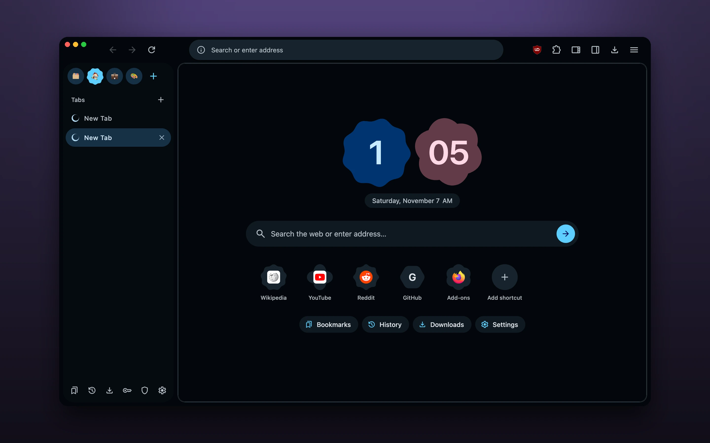
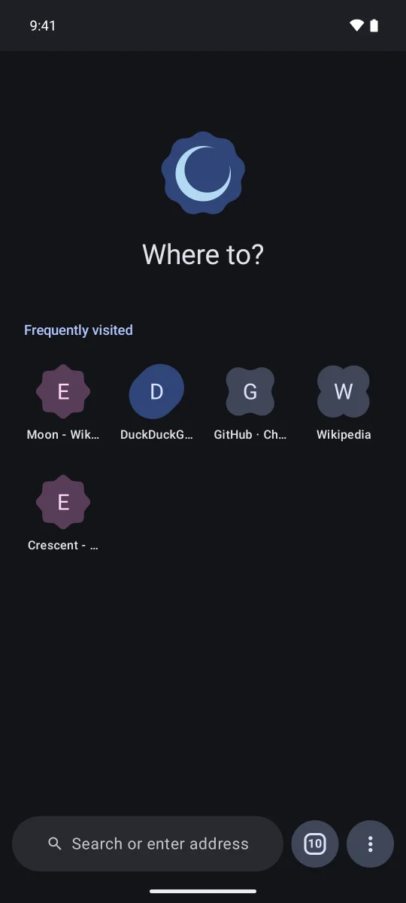
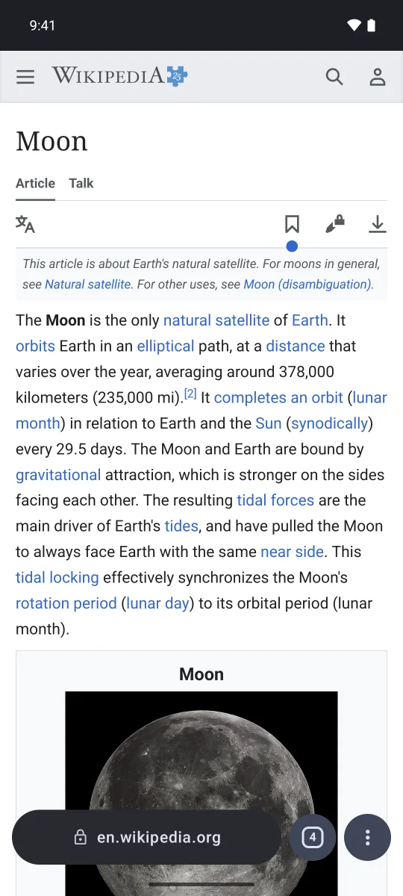
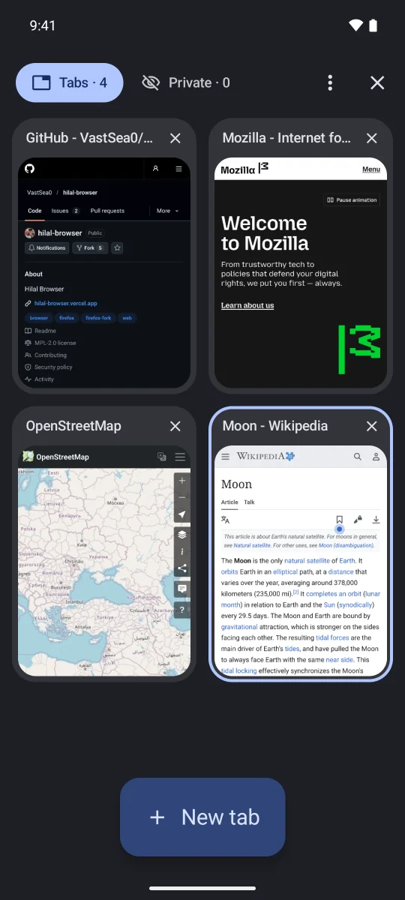
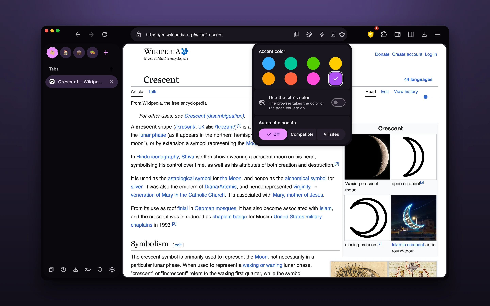
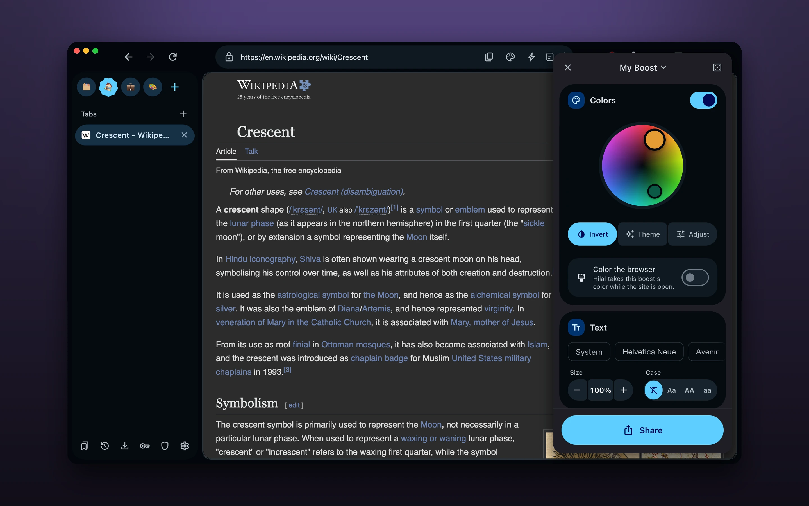
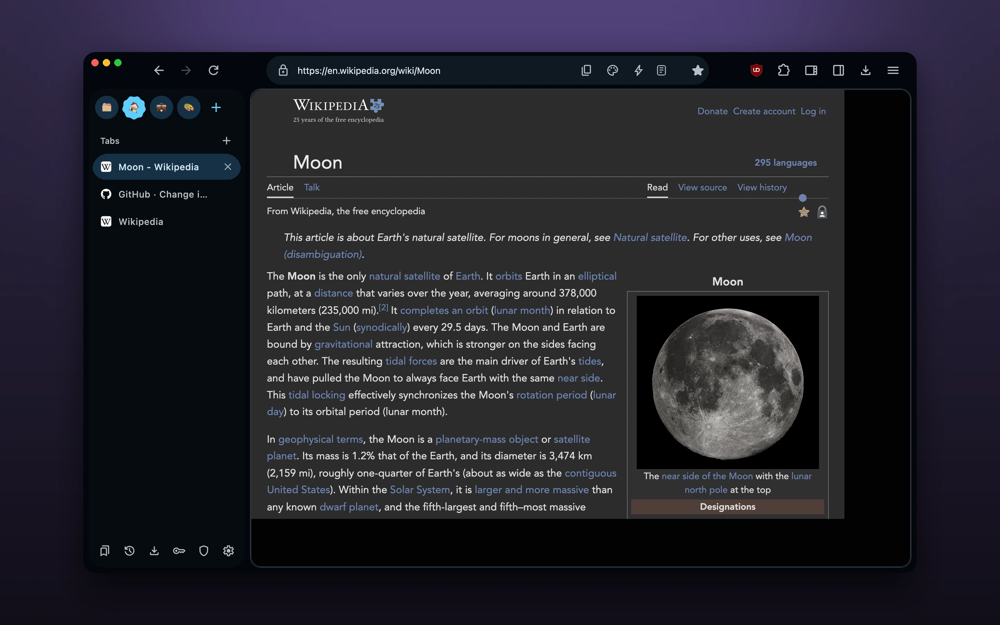
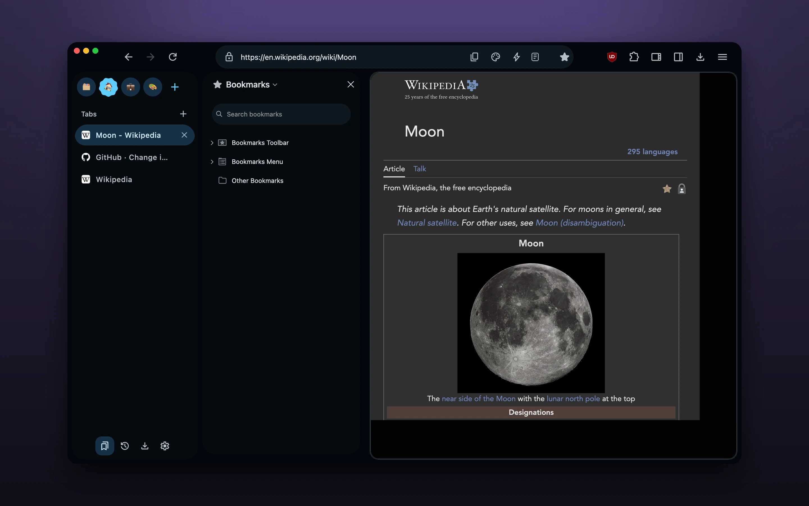
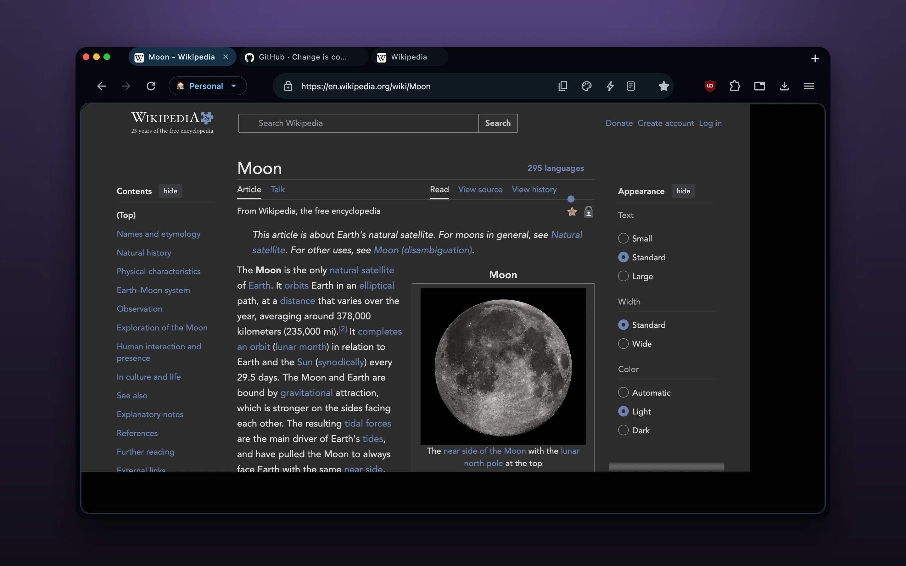
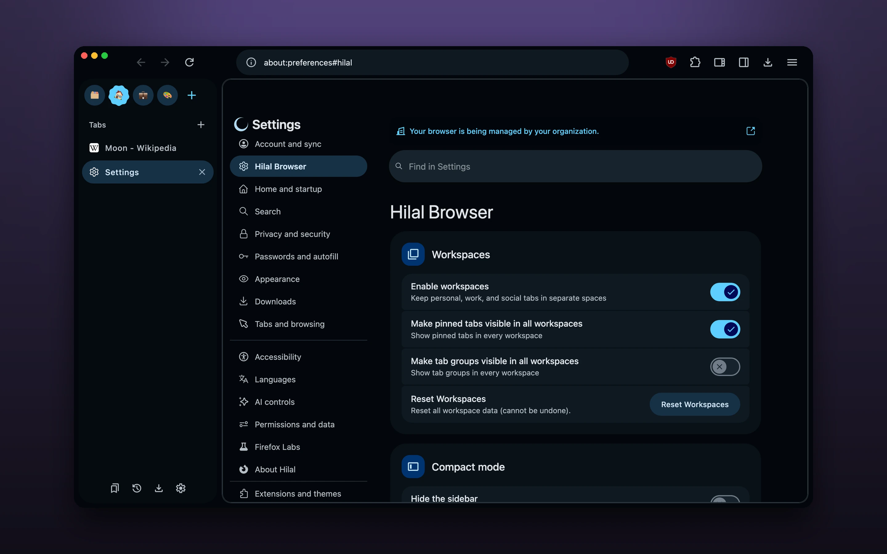

# Hilal Browser

<p align="center">
  
</p>

<p align="center">
  <a href="https://github.com/VastSea0/hilal-browser/releases"></a>
  <a href="https://github.com/VastSea0/hilal-browser/actions/workflows/verify-patches.yml"></a>
  <a href="https://discord.gg/JZJ4tmPHFw"></a>
  <a href="LICENSE"></a>
</p>

<p align="center">
  
</p>

<p align="center">
  
  
  
</p>

Hilal is an experimental desktop browser built on Firefox ESR. It combines isolated workspaces, a Material 3 Expressive interface, and configurable privacy profiles while retaining Gecko and Firefox extension compatibility.

The project is in alpha and was previously developed as Huma Browser.

## Features

### Interface

- Material 3 Expressive shell with its own top bar, address bar, sidebar, menu and color panel
- Vertical sidebar tabs, a horizontal tab strip, or both, switchable at any time
- Light, dark, and system themes with per-workspace or global accent colors
- Material 3 Expressive shapes on the new tab page, the About dialog and error pages
- Settings, the About dialog and Firefox's own panels restyled to match

### Colors and Boosts

- Boosts restyle any site: recolor it without touching images, turn it dark, change its font and text size, zap elements away, or keep only what matters with Focus
- Boosts can be shared as a link and can color the browser while their site is open
- Automatic boosts recolor sites you have not boosted, on every site or only where it fits
- The browser can take each site's own color, from its theme color or a guess from its design

### Workspaces

- Separate container context for each workspace
- Optional shared pinned tabs and tab groups
- Workspace creation, switching, and visibility controls
- First-run setup for theme, tab layout, workspaces, privacy level, search engine, and pinned sites

### Browser controls

- Custom and built-in search bangs in the address bar
- Editable keyboard shortcuts for Hilal actions and Firefox commands
- Balanced, Strict, and Maximum local privacy profiles
- uBlock Origin included by default
- Telemetry disabled by default
- In-browser language selection and Turkish localization

Privacy profiles are hardening presets, not anonymity modes; they do not hide your public IP address.

## See it in action

| | |
|---|---|
|  |  |
| **Colors that follow you.** Each workspace has an accent color; the palette button also lets the browser take each site's own color. [Video](media/features/videos/02-colors.mp4) | **Boosts.** Recolor any site, turn it dark, change its font and size, then share it as a link. [Video](media/features/videos/03-boosts.mp4) |
|  |  |
| **A menu of its own,** with sub pages for tools and help. [Video](media/features/videos/04-menu-sidebar-layouts.mp4) | **Bookmarks and history** open right next to your tabs. |
|  |  |
| **Tabs your way:** in a sidebar, along the top, or both. | **Settings** in the same style, Firefox's own panes included. [Video](media/features/videos/05-settings.mp4) |

More images and videos, and what each one shows, are in [media/features](media/features/README.md).

## Android

Hilal for Android is a separate app built on GeckoView with a Material 3
Expressive interface, gesture-driven address bar, and uBlock Origin. Its code
lives in [`android/`](android/); see [docs/MOBILE.md](docs/MOBILE.md).

Unlike the desktop browser, the Android app sends an anonymous daily usage
ping, which can be turned off in its settings. The
[privacy policy](https://hilal-browser.vercel.app/privacy.html) lists exactly
what it contains.

## Download

Desktop and Android downloads are available from the
[releases page](https://github.com/VastSea0/hilal-browser/releases) and the
[website](https://hilal-browser.vercel.app).

**macOS:** Hilal is not signed by Apple, so macOS may say the app is damaged.
After dragging it into Applications, run this once in Terminal:

```bash
xattr -dr com.apple.quarantine "/Applications/Hilal Browser.app"
```

See [docs/INSTALL-MACOS.md](docs/INSTALL-MACOS.md) for details.

## Build from source

Install the [Firefox build prerequisites](https://firefox-source-docs.mozilla.org/setup/index.html) for your platform first. Rust is also required to compile the `hil` patch manager.

```bash
git clone https://github.com/VastSea0/hilal-browser.git
cd hilal-browser

cargo build --release --manifest-path hil/Cargo.toml
mkdir -p bin
cp hil/target/release/hil bin/hil

./bin/hil setup
./bin/hil apply
```

Then run the build script for your platform:

```bash
scripts/build-macos.sh
scripts/build-linux.sh
```

On Windows, use `.\scripts\build-windows.ps1`. See [docs/BUILD-WINDOWS.md](docs/BUILD-WINDOWS.md) for the required environment and setup steps.

## Development

This repository contains the Hilal-specific patches, overlays, and build tooling. The Firefox source checkout is created in the gitignored `engine/` directory.

```text
changes/        patches and overlay files
manifest.toml   patch and overlay order
upstream.lock   pinned Firefox revision
engine/         local Firefox checkout
```

Source changes are made in `engine/`. Run `./bin/hil refresh` afterward to regenerate the files under `changes/`, then review and commit those files in this repository.

The complete patch workflow, including conflict resolution, is documented in [docs/WORKFLOW.md](docs/WORKFLOW.md). Other build, release, localization, and upstream sync notes live in [`docs/`](docs/).

## Contributing

Contributions are welcome. Start with [CONTRIBUTING.md](CONTRIBUTING.md), and
report security issues as described in [SECURITY.md](SECURITY.md). Questions
and discussion happen on [Discord](https://discord.gg/JZJ4tmPHFw).

## Star History

<a href="https://www.star-history.com/?repos=VastSea0%2Fhilal-browser&type=timeline&legend=top-left">
  <picture>
    <source media="(prefers-color-scheme: dark)" srcset="https://api.star-history.com/chart?repos=VastSea0/hilal-browser&type=timeline&theme=dark&legend=top-left" />
    <source media="(prefers-color-scheme: light)" srcset="https://api.star-history.com/chart?repos=VastSea0/hilal-browser&type=timeline&legend=top-left" />
    
  </picture>
</a>

## Open source

Hilal is built on [Firefox ESR](https://www.mozilla.org/firefox/enterprise/) and uses other open source projects:
Boosts adapted from [Zen Browser](https://github.com/zen-browser/desktop), menu icons from
[Firefox-UI-Fix](https://github.com/black7375/Firefox-UI-Fix), [Beer CSS](https://github.com/beercss/beercss)
and [M3E](https://github.com/matraic/m3e) for the Material interface, the
[Material Symbols](https://github.com/google/material-design-icons) font, and a bundled
[uBlock Origin](https://github.com/gorhill/uBlock). The Android app uses
[GeckoView](https://mozilla.github.io/geckoview/) and Jetpack Compose. See
[THIRD_PARTY_NOTICES.md](THIRD_PARTY_NOTICES.md) for what each one does, how it is included, and its
license. Inside the browser, `about:license` lists them under "Hilal Browser Components".

## License

Hilal's patches, scripts, and other source files are available under the [Mozilla Public License 2.0](LICENSE). Branding assets are copyright Hilal Browser contributors.
